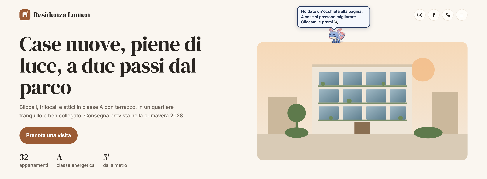
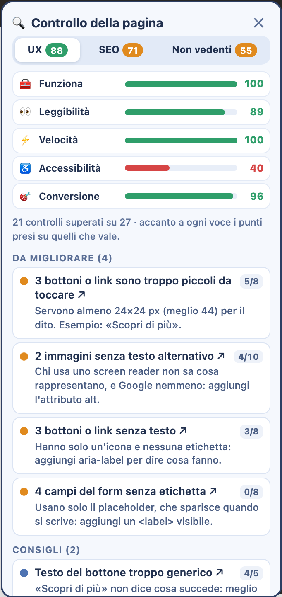
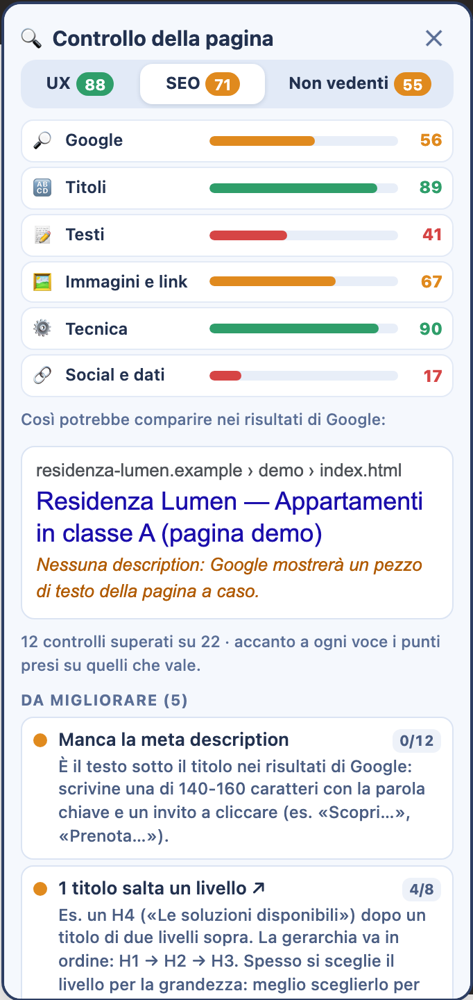
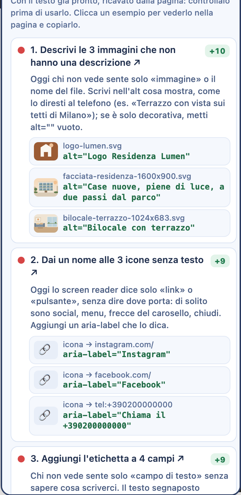
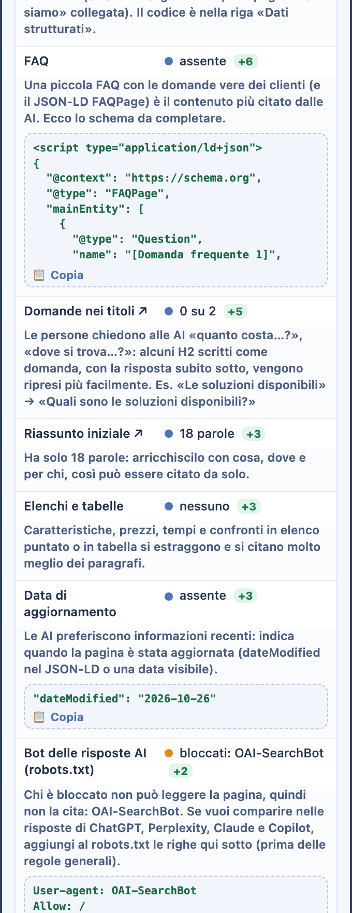
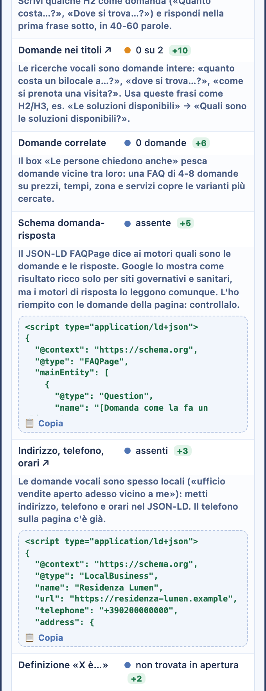
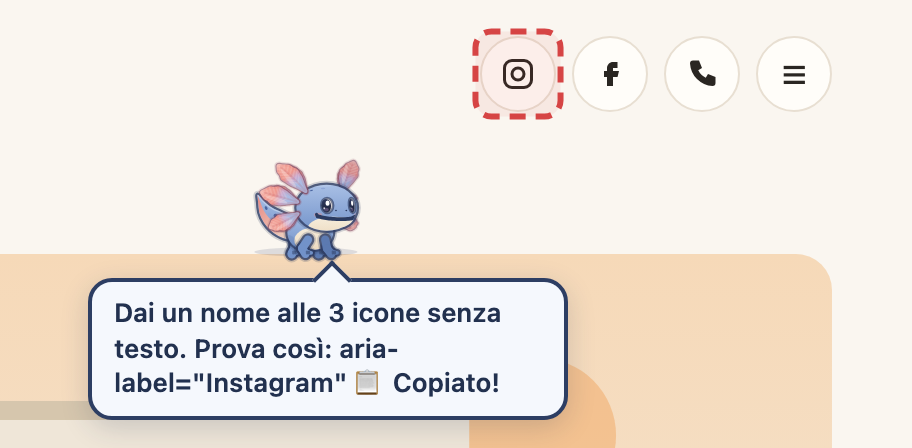
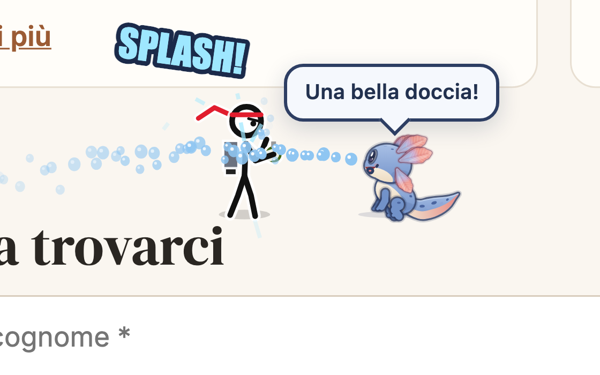

<p align="center"></p>

# Nimblu

**Un’estensione per Chrome che controlla UX, SEO, GEO e AEO (le risposte delle AI e dei motori di risposta) e accessibilità di qualsiasi pagina web. E intanto ci vive sopra.**

Nimblu è una mascotte (un axolotl) che cammina sulle pagine che visiti. Quando glielo chiedi, controlla la pagina e ti dice cosa migliorare: ogni problema ha un voto, una spiegazione e un clic che ti porta dritto all’elemento da sistemare. Nelle pause gioca: fa a botte con l’omino del jetpack, corre come i gatti, insegue la pallina e mangia le lettere (poi le ridà).

▶ **Provalo senza installare niente:** [pagina demo](https://95luida.github.io/nimblu/demo/) · 📄 [Presentazione in PDF](docs/Nimblu-presentazione.pdf)

> Interfaccia e testi in italiano.

<p align="center"></p>

## Il controllo della pagina

Clicca Nimblu → **🔍 Controlla la pagina**. Si apre un pannello con cinque schede (UX, SEO, GEO, AEO e Non vedenti), ognuna con il suo voto da 0 a 100 e le barre per categoria. Le regole sono più di 100, fisse, e girano tutte nel browser (la scheda GEO legge anche `robots.txt` e `llms.txt` del sito).

| UX e conversione | SEO | Non vedenti |
|---|---|---|
|  |  |  |

**UX e conversione**
- *Funziona:* immagini e file che non si caricano, popup che coprono la pagina, scroll laterale, link vuoti, testo segnaposto.
- *Leggibilità:* contrasto del testo, caratteri troppo piccoli, bottoni piccoli da toccare, pagina pronta per il telefono.
- *Velocità:* tempo del contenuto principale (LCP) e stabilità mentre carica (CLS), misurati dal browser; immagini troppo pesanti.
- *Accessibilità:* immagini senza descrizione, bottoni senza nome, campi senza etichetta, titolo H1.
- *Conversione:* call to action visibile subito, testi dei bottoni, form brevi, contatti, recensioni e garanzie.

**SEO**, con l’anteprima del risultato su Google
- title e meta description (presenza, lunghezza, che non siano uguali);
- titoli H1–H6: un solo H1, livelli in ordine, titoli vuoti, ripetuti o troppo lunghi;
- testi: quantità, leggibilità con l’indice Gulpease, parola chiave e dove compare;
- immagini e link: testi alternativi, nomi dei file, link interni, link generici;
- tecnica: noindex/nofollow, canonical, lingua, HTTPS, indirizzo, favicon;
- social e dati: Open Graph e dati strutturati schema.org.

**GEO** (Generative Engine Optimization): farsi trovare e citare da ChatGPT, Perplexity, Gemini e dai riassunti AI di Google
- *Accesso AI:* il `robots.txt` lascia entrare i bot delle risposte (OAI-SearchBot, ChatGPT-User, PerplexityBot, Claude-SearchBot, Bingbot, Googlebot)? Il testo si legge anche senza JavaScript? Niente `nosnippet`? C’è un `llms.txt`?
- *Risposte:* riassunto iniziale chiaro, titoli scritti come domande, FAQ, elenchi e tabelle, dati concreti (m², €, %, date), paragrafi brevi;
- *Fiducia:* chi parla (azienda o autore), data di aggiornamento, fonti esterne citate, contatti;
- *Dati strutturati:* JSON-LD presente, azienda riconoscibile (Organization con i profili social in `sameAs`), BreadcrumbList.

<p align="center"></p>

Tutto finisce in una **tabella segnale per segnale**: cosa c’è sulla pagina, come migliorarlo, quanti punti vale e, dove si può, il testo pronto da copiare (righe per il `robots.txt`, JSON-LD FAQPage costruito dalle domande della pagina, Organization con i social trovati, bozza di `llms.txt`).

**AEO** (Answer Engine Optimization): le risposte dirette nei riquadri in evidenza di Google, in «Le persone chiedono anche» e negli assistenti vocali
- *Risposte brevi:* sotto ogni domanda una risposta di 40-60 parole che parte dalla risposta (senza «Ecco…», «In questo articolo…»), una definizione chiara «X è…»;
- *Domande:* titoli scritti come domande intere, come le fa la gente, e un blocco di domande correlate;
- *Formati:* passaggi numerati per le procedure, tabelle per prezzi e confronti, elenchi brevi;
- *Voce e schema:* frasi brevi da leggere ad alta voce, JSON-LD FAQPage già riempito con le domande della pagina, Speakable, LocalBusiness con indirizzo, telefono e orari per le domande vocali «vicino a me».

<p align="center"></p>

Anche qui una tabella segnale per segnale, con il testo pronto da copiare.

**Non vedenti** (per chi usa lo screen reader)

Non dice solo cosa manca: propone il testo da scrivere, ricavato dalla pagina (titolo della card, didascalia, nome del file, indirizzo del link). Sono proposte da rileggere prima di usarle.

```html
alt="Bilocale con terrazzo"                          <!-- foto senza descrizione -->
aria-label="Instagram"                               <!-- icona social senza nome -->
<label> La tua email [email* your-email] </label>    <!-- campo di Contact Form 7 -->
```

Cliccando un esempio, la pagina scorre fino all’elemento, Nimblu ci salta sopra e il testo viene copiato negli appunti. Se riconosce WordPress, Elementor o Contact Form 7, ti dice anche dove incollarlo.

<p align="center"></p>

### Come nasce il voto

Ogni controllo vale dei punti in base a quanto pesa (la meta description 12, un noindex 25). Se è a posto li prende tutti; altrimenti una parte: *consiglio* 70%, *da migliorare* 35%, *da sistemare* 0%.

```
voto = punti presi ÷ punti in palio × 100
```

Lo stesso calcolo vale per ogni categoria. Accanto a ogni consiglio c’è quanti punti guadagni sistemandolo.

### Con l’AI (facoltativa)

Su Chrome 138 o successivo Nimblu può usare **Gemini Nano**, il modello integrato in Chrome: gira sul computer (se lo supporta), senza chiavi e senza server. Riceve una scheda della pagina con i problemi trovati e risponde con 3–5 consigli scritti per quella pagina, ognuno collegato al punto da sistemare. Si attiva dal pannellino dell’estensione. Senza AI i controlli funzionano lo stesso.

## Pensato per chi lavora sui siti

- **Non rovina le pagine di lavoro:** negli editor (WordPress, Elementor, Divi, Webflow, Google Docs, Canva, ActiveCampaign e altri) e nei campi di testo le funzioni che toccano la pagina sono spente.
- **Si fa da parte:** «Nascondi su questo sito», modalità Calmo o Angolo, chiacchiere e consigli automatici da spegnere.
- **Barra di WordPress:** quando sei loggato può togliere la barra nera dall’anteprima del sito, e la rimette quando glielo chiedi.
- **Tutto resta sul computer:** impostazioni, memoria e cronologia della chat sono salvate in Chrome.

## Installazione su Chrome

1. Scarica **`estensione-nimblu.zip`** dalla pagina [Releases](https://github.com/95luida/nimblu/releases/latest).
2. Estrai lo zip: ottieni la cartella `estensione-nimblu`.
3. Apri `chrome://extensions` e attiva **Modalità sviluppatore** (in alto a destra).
4. Premi **Carica estensione non pacchettizzata** e scegli la cartella estratta.
5. Fissa l’icona di Nimblu dal pezzo di puzzle accanto alla barra degli indirizzi.

**Per aggiornare:** scarica la nuova versione, sostituisci la cartella e premi ↻ su Nimblu in `chrome://extensions`.

Nimblu non è sul Chrome Web Store, per questo serve la modalità sviluppatore. I permessi sono `storage`, `activeTab` e `offscreen` (per l’AI); lo script gira su tutte le pagine perché Nimblu ci deve camminare sopra.

## Altri modi per provarlo

- **Demo:** [95luida.github.io/nimblu/demo](https://95luida.github.io/nimblu/demo/), una landing inventata con errori lasciati apposta.
- **Segnalibro:** dalla [pagina del progetto](https://95luida.github.io/nimblu/) trascina «💧 Nimblu» nei preferiti; un clic e compare sul sito che stai guardando (non funziona sui siti che bloccano gli script esterni).

## E nelle pause

<p align="center"></p>

Fa a botte con l’omino del jetpack (lo puoi comandare tu col mouse: pugni, pistola, fiamme, raggi e granate), si arrampica, corre come i gatti, insegue la pallina, nuota e mangia le lettere. Alla fine della rissa la pagina torna com’era.

## Come è fatto

```
mascot.js            tutto Nimblu: disegno su canvas, movimento, chat, controlli UX / SEO / non vedenti
estensione-nimblu/   estensione Chrome (Manifest V3): content script, popup, service worker, offscreen per l’AI
nimblu-app/          versione «animaletto da tasca» per il telefono (PWA)
demo/                pagina demo con errori lasciati apposta
index.html           pagina del progetto con i segnalibri
stickman.js          l’omino distruttore da solo, come segnalibro
docs/                presentazione in PDF e immagini
```

Un solo file, `mascot.js` (circa 6.400 righe di JavaScript, nessuna dipendenza), usato da estensione, demo e segnalibro. I controlli sono tre funzioni (`audit`, `seoAudit`, `a11yAudit`) con lo stesso schema: ogni controllo dichiara categoria e peso, poi aggiunge un risultato con il suo punteggio.

Se modifichi `mascot.js`, copialo anche in `estensione-nimblu/` e `nimblu-app/`.

## Problemi e idee

Una pagina dove Nimblu sbaglia, un controllo che manca, un’idea: apri una [issue](https://github.com/95luida/nimblu/issues).

## Licenza

[MIT](LICENSE): puoi usare, modificare e ridistribuire il codice, citando l’autore.
